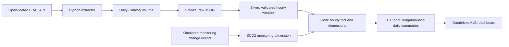

# Hungarian Weather Lakehouse

**An end-to-end Data Engineering portfolio project using Databricks, Python, SQL, and Open-Meteo ERA5 historical weather data.**

This project collects hourly weather observations for five Hungarian cities, processes them through a Bronze–Silver–Gold lakehouse, and presents the results in an interactive Databricks AI/BI dashboard. The workflow is orchestrated with Lakeflow Jobs and includes automated data-quality checks, historical dimension tracking, and UTC-aware reporting.

> **Project status:** The four-task orchestration workflow has been tested successfully. A daily schedule is configured for **08:00 UTC**.

## Architecture



See [the detailed architecture and orchestration diagram](docs/architecture.md).

## Technologies

| Component | Technology |
| --- | --- |
| Data source | Open-Meteo Historical Weather API, ERA5 reanalysis |
| Extraction | Python, `requests` |
| Storage | Unity Catalog Volumes, Delta Lake |
| Transformations | Databricks SQL, Spark Declarative Pipelines (Lakeflow) |
| Ingestion | Auto Loader streaming table |
| Orchestration | Databricks Lakeflow Jobs |
| Data modeling | Kimball-style star schema; SCD Type 2 |
| Reporting | Databricks AI/BI dashboard |
| Version control | Git and GitHub |

## Data and processing

**Cities:** Budapest, Debrecen, Szeged, Pécs, and Győr.

**Weather measures:** hourly temperature at 2 m (°C), precipitation (mm), and wind speed at 10 m (km/h). Source timestamps are requested in **UTC**.

- **Bronze — `bronze.weather_raw`:** Stores one unmodified Open-Meteo JSON response per incoming file, plus source-file and ingestion metadata.
- **Silver — `silver.weather_hourly`:** Flattens hourly arrays, parses timestamps, enforces quality expectations, and selects one record per `(city, hour_utc, weather_model)`.
- **Gold — `gold.fact_hourly_weather`:** Stores measurements at the grain of one **location × UTC hour × weather model** with dimension keys.
- **Gold dimensions:** `dim_location`, `dim_date`, `dim_weather_source`, and `dim_monitoring_status`.
- **Gold summaries:** `daily_weather_summary` uses UTC dates; `daily_weather_local` uses Hungarian calendar dates with daylight-saving-aware completeness checks.

### SCD Type 2 demonstration

A **simulated monitoring-priority system** provides change events (for example, *Standard*, *Priority*, and *Critical*). These are invented business records used to demonstrate historical dimension management; they are **not attributes provided by Open-Meteo**.

A separate SQL `MERGE` maintains historical monitoring versions in `gold.dim_monitoring_status`. A deliberately late-arriving event tests whether existing validity periods adjust while historical surrogate keys remain stable. The Gold fact associates observations with the monitoring version effective at the observation date.

See [`sql/demo_late_arriving_monitoring.sql`](sql/demo_late_arriving_monitoring.sql) and [`sql/merge_dim_monitoring_status.sql`](sql/merge_dim_monitoring_status.sql).

## Verified results

The initial complete **2025 UTC extraction** produced **43,800 unique hourly observations** (5 cities × 8,760 hours). Subsequent test deliveries intentionally overlapped existing dates to demonstrate ingestion and deduplication.

The figures below describe the **validated 2025 baseline before scheduled 2026 ingestion began**. Because the Job now ingests additional dates, live total row counts will grow; the 2025 baseline remains useful for reproducing the original checks.

| Baseline check | Validated result |
| --- | ---: |
| Unique hourly observations in Silver | 43,800 |
| Hourly Gold fact rows | 43,800 |
| Unmapped Gold dimension keys | 0 |
| Hungarian-local city-day summary rows | 1,830 |
| Complete 2025 local city-days | 1,820 |
| Incomplete local city-days across full extracted window | 10 |

The local summary spans **2025-01-01 through 2026-01-01** and contains **10 incomplete city-days** across the two UTC extraction boundaries (5 cities × 2 boundary dates). Within the **2025 local calendar**, each city has 364 of 365 complete days.

### UTC versus Hungarian-local reporting

A complete 2025 UTC extraction does **not** cover the first hour of January 1 in the `Europe/Budapest` calendar: that local hour corresponds to December 31, 2024 at 23:00 UTC. The local reporting layer detects this boundary limitation instead of silently presenting a partial day as complete.

The dashboard therefore uses **February–December 2025** for monthly weather comparisons, while its data-quality table evaluates the **entire 2025 Hungarian-local calendar**. Daylight-saving transitions are accounted for: local days can contain 23, 24, or 25 hours.

## Analytics dashboard

The Databricks AI/BI dashboard, **Hungarian Weather Analytics | 2025**, includes:

- Monthly average air temperature by city.
- Monthly precipitation totals by city.
- Monthly maximum hourly wind speed by city.
- Local-calendar completeness and missing-observation indicators.
- An interactive city filter.

The version-controlled dashboard definition is available at [`dashboards/Hungarian Weather Analytics _ 2025.lvdash.json`](dashboards/Hungarian%20Weather%20Analytics%20_%202025.lvdash.json). Viewing the live dashboard requires appropriate Databricks workspace permissions.

## Automated workflow

The Lakeflow Job `weather_lakehouse_orchestration` runs four dependent tasks:

1. **`extract_weather_api`** — Fetch missing eligible daily ERA5 observations for all five cities and write validated raw responses plus separate metadata to a Unity Catalog Volume. A **seven-day delay** and **seven-day lookback** allow short missed-run recovery.
2. **`update_monitoring_scd2`** — Apply SQL `MERGE` to the simulated monitoring-history dimension.
3. **`refresh_weather_pipeline`** — Refresh the Bronze–Silver–Gold declarative pipeline.
4. **`validate_weather_data`** — Assert uniqueness, non-null dimension mappings, SCD2 interval consistency, and hourly-to-daily reconciliation.

The Job is scheduled **daily at 08:00 UTC** and was tested both with new overlapping deliveries and repeated runs of the same date. Repeated execution skipped previously delivered daily files, demonstrating **file-delivery idempotency for the tested case**.

The exported Job configuration is saved as [`jobs/weather_lakehouse_orchestration.yml`](jobs/weather_lakehouse_orchestration.yml). It is a **workspace-specific configuration snapshot**, not a ready-to-deploy bundle: warehouse IDs, pipeline IDs, access permissions, and workspace objects must be configured for another environment.

## Repository guide

```text
src/                            Python extraction, validation, and backfill scripts
sql/                            SCD2 seed/MERGE, late-arrival demo, quality checks
weather_lakehouse_pipeline/     Lakeflow SQL transformations
jobs/                           Exported Job YAML
dashboards/                     Exported AI/BI dashboard definition
docs/                           Architecture documentation
requirements.txt                Local Python dependency list
```

## Reproducing the project

1. Clone the repository, create a Python virtual environment, and install local dependencies with `pip install -r requirements.txt`.
2. Set up a Databricks workspace with appropriate Unity Catalog privileges, the `hungarian_weather_lakehouse` catalog, the required schemas, and a Volume at `/Volumes/hungarian_weather_lakehouse/raw/weather_landing/`.
3. Configure a Lakeflow pipeline using `weather_lakehouse_pipeline/transformations/my_transformation.sql`.
4. Initialize the simulated monitoring events with `sql/seed_monitoring_changes.sql` and create/update the SCD2 dimension using `sql/merge_dim_monitoring_status.sql`.
5. Ingest raw weather JSON using the Python extractor, run the Lakeflow pipeline, and execute `sql/validate_weather_pipeline.sql`.
6. Import the exported AI/BI dashboard definition and adapt the Job YAML to your workspace-specific IDs before creating the scheduled Job.

For a one-time local historical extraction, run `python -m src.backfill_2025`. Raw API response data and extraction metadata are intentionally excluded from Git; they are generated into local data folders or stored in the Unity Catalog Volume.

## Scope and limitations

- The project uses **ERA5 reanalysis data**, not readings from dedicated live weather stations.
- The monitoring-priority SCD2 source is **simulated** for modeling practice.
- The 2025 local-calendar reporting boundary has one missing early-hour observation per city; the dashboard explicitly flags completeness rather than silently backfilling it.
- The seven-day rolling lookback handles short interruptions, not outages of arbitrary duration.
- Existing-file checks prevent duplicate daily files in the tested sequential rerun, but they are not a complete atomic-publishing or concurrency-safe ingestion manifest.
- The exported Job uses workspace-specific resources and requires adaptation before deployment elsewhere.

## Data attribution

Weather data: [Open-Meteo Historical Weather API](https://open-meteo.com/en/docs/historical-weather-api), using ERA5 reanalysis. This repository provides the extraction and transformation code; source weather data files are not included.
