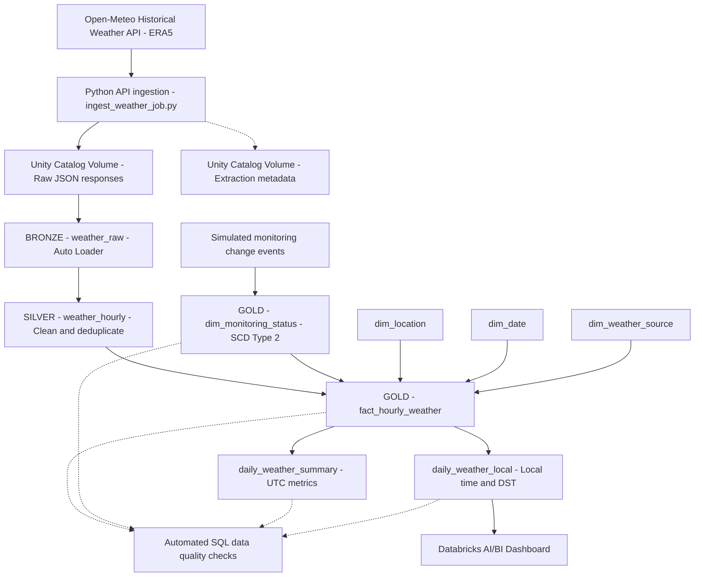

# Hungarian Weather Lakehouse — Architecture

## Orchestration

The pipeline is orchestrated using Databricks Lakeflow Jobs, with four sequential tasks:

1. **API Extraction:** Retrieve missing ERA5 observations from Open-Meteo and write validated JSON responses to a Unity Catalog Volume.
2. **SCD2 Maintenance:** Apply SQL MERGE to synchronize historical monitoring-status versions.
3. **Pipeline Refresh:** Execute the declarative Bronze → Silver → Gold transformations.
4. **Data Quality Validation:** Check fact uniqueness, dimension mappings, SCD2 intervals, and reporting reconciliation.

The Job runs daily at **08:00 UTC**, using a seven-day extraction delay and a seven-day rolling lookback window.

All pipeline source code and the Job configuration are version-controlled in GitHub.
